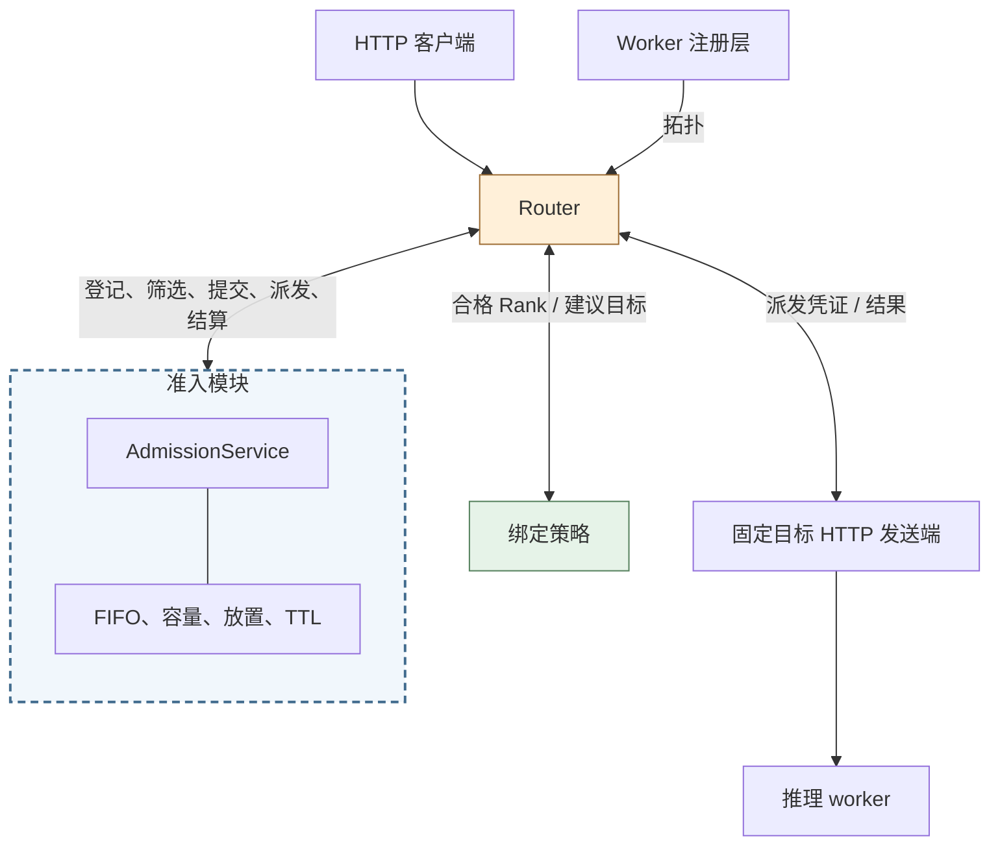
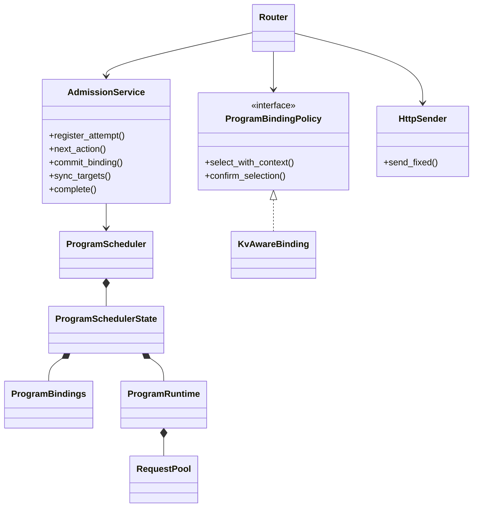
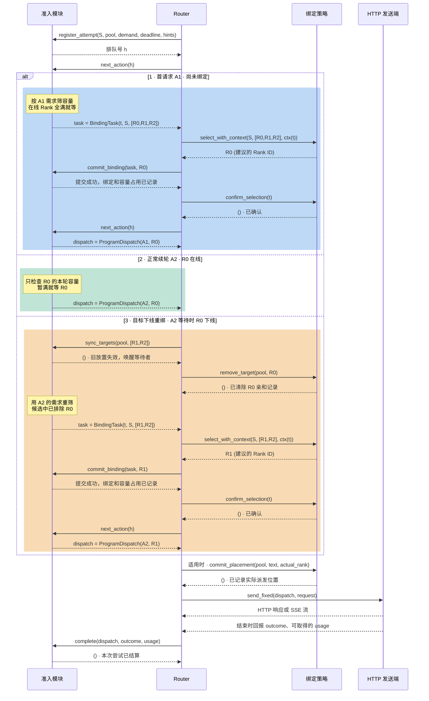
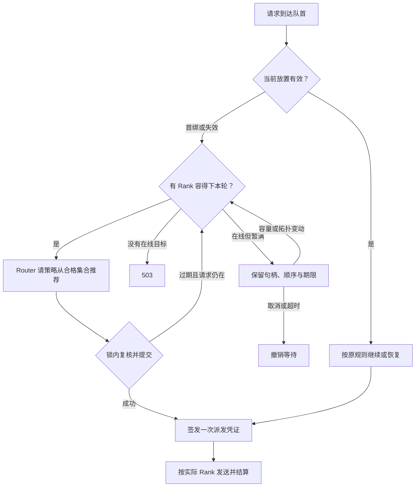

# RFC：router准入模块架构重构

[English](https://github.com/vllm-project/router/issues/634)

**状态** — 提议评审，2026-11-26。适用范围是单个 Router 通过普通 HTTP 混布模型池处理 `POST /v1/chat/completions`，同一后端承担预填充和解码。下文接口为拟议改动。实现依据固定到 Program Scheduling 合入版本及本设计核对的后续 Router 快照。[Program Scheduling PR][pr] · [Router 配置与身份协议][guide]

本 RFC 提议把 Router 已有的 Program Scheduling 抽成**会话级准入模块**。本期只覆盖有效 `program_id = session_id` 的会话。客户端只传 `session_id` 时，Router 将它原值填入 `program_id`。同一模型池中，同一会话的多轮请求按顺序进入同一条 Program 队列。在完整调度模式下，准入模块先判断哪些 Rank 接得下队首请求。需要建立绑定时，Router 才调用 policy 选点，再凭准入模块签发的派发凭证发送。队列、容量和暂停恢复继续由同一个调度器管理。

## 1. 现有调用链与重构动因

以完整调度模式下一个新 Program 的首请求为例，现有实现分三步处理。

1. HTTP Router 解析请求身份，将本轮需求、目标快照和可选路由文本传给 `acquire_from_snapshot`。调度器登记请求，找到它所属的 Program。[HTTP 调度入口][http-entry] · [请求登记与调度][acquire]
2. 调度器在状态锁内通过 `ProgramBindings.bind` 查找已有绑定。需要建立绑定时，绑定表把候选按目标 ID 排序，在内部调用 `ProgramBindingPolicy.select`，并写入初始 Rank。候选已有 `immediately_admissible` 标记；现有 `cache_aware` 优先使用带标记的候选，全部不合格时仍可从完整集合选点。[原绑定表][binding] · [候选容量估算][candidates] · [缓存感知选点][existing-policies]
3. 调度器按 FIFO、容量和恢复规则推进请求，可派发时给出 `ProgramDispatch`。HTTP 按指定目标发送，结束时结算。因此，“已有绑定”和“本轮可以发送”在现有实现中就可能发生在不同时间。[派发实现][dispatch] · [指定目标 HTTP 路径][send]

重构针对两个具体问题。第一，首次绑定藏在调度状态锁内。如果把依赖请求内容的 `kv_aware` 接到这里，分词和缓存查询就会进入调度器的调用链。第二，完整容量门槛与绑定策略看到的候选范围并不一致，Program 可能先绑定到暂时无法放行的 Rank。把候选筛选和绑定提交留在准入模块，把评分交给 Router 在锁外调用，可以同时解决这两个问题。

## 2. 目标架构与职责迁移

准入模块回答“这轮请求可以在哪些 Rank 上开工”，policy 回答“这些 Rank 中选哪个”。筛选与提交之间容量可能变化，所以 Router 拿到建议后还须交回准入模块复核。只有 `ProgramDispatch` 可以交给 HTTP 发送端。下图的虚线框标出调度状态的所有者。

### 2.1 模块调用关系



| 组件 | 现有实现 | 重构后的职责 |
| --- | --- | --- |
| Router | 调用调度器等待派发凭证，再进入指定目标的 HTTP 路径。 | 串起登记、选点、提交、派发和结算。持有只读请求视图，在调度锁外调用 policy，并转发拓扑和派发通知。 |
| 准入模块 | `ProgramScheduler` 已持有请求池、FIFO、逻辑容量、当前位置和 TTL 状态。其绑定表还持有 policy。 | 以 `AdmissionService` 暴露原调度核心，复用同一份状态。按队首需求筛选容量，在锁内复核并写入绑定、记占用，随后签发派发凭证。 |
| 绑定策略 | 由绑定表调用，接收在线候选和可选路由文本。 | 由 Router 调用，接收容量合格的候选和按需提供的只读上下文。策略保管轮询游标、缓存亲和等算法状态。 |
| HTTP 发送端 | 已可向调度器指定的 worker 发送，并处理响应或流结束。 | 复用指定目标路径，按实际获准的 Rank 发送。启用 KV 负载记账时，为这次发送取得一份回执。 |

### 2.2 类与状态所有权

等待句柄对应一条已登记请求。选点票据标识本代 Program 中唯一有权提交建议的认领者。派发凭证标识实际目标和已派发尝试。



## 3. 会话如何复用 Program 调度

一个已启用准入的会话 `S` 对应一个 Program，调度器用 `(model_pool, S)` 找到它。在同一代际内，首请求和续轮共享一条 FIFO 和当前 Rank 绑定。每轮可以有不同的 `request_id`。代际释放后，下一次使用 `S` 可以重新选点。[绑定键][binding]

| 请求提供的身份 | 准入登记结果 |
| --- | --- |
| `session_id=S`，未提供 `program_id` 或当前 Agent 标识 | Router 将 `S` 原值填入 `program_id`，即使请求还带有 `task_id`。 |
| `session_id=S`，显式 `program_id=S` | 直接使用 `S`。与上一种写法使用同一条会话队列。 |

Router 按已有的 `program_scheduling_enable_key` 判断请求是否启用调度。固定快照中的解析器会将仅带 `session_id=S` 的请求派生成 `S:lead`，本提案将这种输入登记为 `S`。缺少会话 ID、有效 Program ID 与会话 ID 不同，以及同一会话拆为多个 Program 的情况均不在本期范围内。[现有解析器][identity-parser] · [启用条件][guide]

## 4. 首绑、续轮与故障重绑

以下按单个模型池、完整调度、默认硬亲和说明。会话 S 的 `program_id = session_id = S`。这里的 `WAITING` 和 `GO` 表示准入模块内部判断“这条请求能否往下走”。`GO` 之后仍要检查容量。`next_action` 在需要选点时返回 `BindingTask`，在允许发送时返回 `ProgramDispatch`。

```text
请求进入 Router
  → 准入登记本轮需求和截止时间，把请求放进会话 S 的 FIFO。
  → 判断是否轮到这条请求。
      WAITING → 还没到队首，或暂未轮到它调度 → 留在原位，等调度器唤醒。
      GO      → 已到队首且轮到它调度 → 查看会话 S 当前的 Rank 绑定。

  ① 首请求 A1，尚未绑定 Rank
      → 准入按 A1 的需求，逐个检查在线 Rank 的容量。
          全部暂满 → 保持未绑定，按原顺序等待容量变化，再检查。
          全部下线 → 返回无可用目标（HTTP 503）。
          有 Rank 可接 → 准入把合格名单和选点票据交给 Router，例如 [R0, R1, R2]。
      → Router 调用 policy，只从名单里选一个最合适的 Rank，例如 R0。
      → Router 把 R0 和票据交回准入，再查一次 R0 是否在线、是否还有容量。
          已满或已下线 → 放弃这次建议，保留原排队号和期限，重新筛选。
          复核通过     → 在同一次更新中绑定 S 到 R0，并记入逻辑容量占用。
                       → Router 向 policy 确认选择，再用原排队号领取派发凭证。

  ② 后续请求 A2，当前绑定的 R0 仍在线（硬亲和）
      → Program Scheduling 沿用已有规则，检查 A2 在 R0 上需要的新增容量；
        如果会话已暂停，则按原有的恢复规则判断能否在 R0 恢复。
          暂不能放行 → 等在 R0，即使 R1 空闲也不改投，不调用 policy。
          可以放行   → 按原规则记账，返回发往 R0 的派发凭证。
      → 若 A3 在 A2 等待时到达，A3 排在 A2 后面，轮到它时再检查。

  ③ 后续请求 A2，当前绑定的 R0 已下线
      → 准入作废失效的绑定和票据，保留 A2 的排队号、顺序和期限。
      → 对剩余在线 Rank 重走 ①：准入筛容量 → 原 policy 选点 → 准入复核并重绑。
      → 若下线时会话没有待发请求，等下一轮真实请求到达，再按该轮需求重绑。

  三条路径获准派发后
      → Router 将派发凭证交给 HTTP 发送端 → 只向凭证上的 Rank 发送。
      → 请求或流结束 → Router 用原凭证回报结果和用量，准入结算本次尝试。
```

首请求“出队后交给 policy”指 Router **领取队首的选点任务**。选点期间，准入保留原队首记录，后续请求按原顺序等待。如果 R0 的最后一点容量被别的会话先占了，A1 仍用原排队号重试。等待超时返回 429，取消等待则撤销对应请求。

各模块传了什么、返回了什么，见第 5.2 节的接口时序图。

## 5. 外部协议与内部接口改造

### 5.1 客户端协议

客户端提交一次聊天请求，取得普通响应或 SSE 流。默认身份来源下，仅传 `vllm_xargs.agentic_context.session_id` 即可进入会话准入，例如 `{"vllm_xargs":{"agentic_context":{"session_id":"S"}}}`。`register_attempt` 接收 Router 已补全的内部身份。非法身份返回 **400**，排队超时返回 **429**，无目标或凭证指定的 worker 不可用返回 **503**。池中仍有在线 Rank 但容量暂满时，在原截止时间内继续等待。[现有 HTTP 错误映射][http-errors]

### 5.2 Router 与各模块的接口

会话 `S` 的每次请求都从图顶端登记。到了 `alt`，按请求情况读对应编号的分支：**1 · 蓝色**为首请求，**2 · 绿色**为正常续轮，**3 · 琥珀色**为当前 Rank 下线后的重绑。三条路径拿到 `ProgramDispatch` 后，都接着读底部的发送与结算。实线是调用和入参，虚线是返回的数据，`()` 表示调用完成且没有返回数据。



`h` 是本次请求的排队号。`task` 含会话 `S`、选点票据 `t` 和通过容量检查的候选名单。`ctx(t)` 表示带票据的选点上下文，按需附上路由文本或只读请求。如果 `commit_binding` 复核时发现目标已满或失效，返回“重新评估”。Router 用原 `h` 再次等待，保留队列位置和期限。分支 3 中的拓扑通知由 Rank 下线事件触发；若当时没有待发请求，则等下一轮到达后再选点。

| 调用方 → 接收方 | 接口 | 输入（调用方传什么） | 输出（调用方拿到什么） | 调用后发生什么 |
| --- | --- | --- | --- | --- |
| Router → 准入 | `register_attempt(identity?, pool, demand, deadline, hints)` | `identity?` 是解析出的会话身份（如 `program_id=S`），可以为空。`pool` 是模型池，`demand` 是本轮预计需要的容量（如上下文和预计输出的 token 数），`deadline` 是最晚等到什么时候，`hints` 是优先级等调度提示。 | 进入准入时返回排队号 `handle`。走普通路由时返回 `UseNativePolicy`。 | 准入只登记这次尝试一次。拿到排队号时，还没有占用任何 Rank 的容量。 |
| Router → 准入 | `next_action(handle)` | 登记时拿到的同一个 `handle`。 | 需要选点时返回 `BindingTask`，内含 `ticket`、会话身份和有序的合格 Rank 名单。可以发送时返回 `ProgramDispatch`，内含实际 Rank 和本次尝试的信息。等待因取消、超时或错误结束时，返回相应原因。 | 拿到 `BindingTask` 就去问 policy，拿到 `ProgramDispatch` 就交给 HTTP。暂时轮不到或在线 Rank 全满时，调用继续等待。 |
| Router → policy | `select_with_context(identity, candidates, context)` | `identity` 和 `candidates` 来自 `BindingTask`，分别是会话身份和合格 Rank 名单。`context` 带上本次 `ticket`，还可提供路由文本或只读请求内容供评分。 | 一个建议的 Rank ID（如 `R0`）、无建议，或策略错误。 | Router 把建议交给准入复核。评分不占 Rank 容量，也不记 worker 执行负载。无建议时在原期限内等候变化，策略错误则结束本次尝试。 |
| Router → 准入 | `commit_binding(task, proposed_rank)` | `task` 是 `next_action` 给的原 `BindingTask`。`proposed_rank` 是 policy 从这份名单里推荐的 Rank ID，如 `R0`。 | 返回提交结果。成功表示绑定和容量占用已记好。票据过期或容量不足时，结果会要求重新评估。 | 准入在同一把锁内复核并记账。成功后 Router 用 `ticket` 确认选择，再用原 `handle` 领取派发凭证。需要重评时也沿用原 `handle`。 |
| Router → policy | `confirm_selection(ticket)` | 提交成功的 `BindingTask` 里的 `ticket`。 | 无返回数据。 | 策略按票据确认这次选择。例如轮询游标前进一格，重复确认同一张票据也只走一格。 |
| Router → 准入 | `sync_targets(pool, snapshot)` | `pool` 是有变动的模型池，`snapshot` 是该池最新的在线 Rank 名单。 | 无返回数据。等待中的请求通过各自的 `next_action(handle)` 得到后续结果。 | 准入更新名单。如果当前 R0 已下线，就作废受影响的放置，并唤醒有请求在等的会话。 |
| Router → policy | `remove_target(pool, rank)` | `pool` 是所属模型池，`rank` 是下线的 Rank ID，如 `R0`。 | 无返回数据。 | 策略清理该池中指向 R0 的亲和记录。 |
| Router → policy | `commit_placement(pool, text, rank)` | `pool` 是模型池，`text` 是用于判断亲和性的路由文本，`rank` 是本次实际派发的 Rank ID。 | 无返回数据。 | 用到文本亲和性的策略记住“这段文本发到了哪个 Rank”。续轮也可以报告实际位置，无需重新选点。 |
| Router → HTTP 发送端 | `send_fixed(dispatch, request)` | `dispatch` 是准入签发的 `ProgramDispatch`，指定了目标 Rank。`request` 是本轮实际要转发的 HTTP 请求。 | 发送成功时得到普通 HTTP 响应或 SSE 流。失败时得到发送错误或相应错误响应。尝试结束时向 Router 报告结果和可取得的用量。 | 发送端只向凭证指定的 Rank 发送。流式请求在流结束或断开时结算。 |
| Router → 准入 | `complete(dispatch, outcome, usage)` | `dispatch` 是发送时用的原凭证，`outcome` 是成功、失败或取消，`usage` 是后端实际报告的用量，例如输入、输出和命中缓存的 token 数。未报告的值可以缺省。 | 无返回数据。 | 准入按原凭证结算这一次尝试，重复报告也只结算一次。 |
| Router → 准入 | 释放等待句柄 `handle` | 仍在等待的那一次尝试的 `handle`。Router 取消等待时释放它。 | 无返回数据。这是释放句柄的动作。 | 准入移除对应的排队记录，收回该请求持有的选点票据。同一会话的其他请求保留原有顺序。 |

**发送端内部的 `account_fixed_target`。** 启用 KV 负载记账时，由 `send_fixed` 调用。**输入**是凭证指定的实际 worker/Rank，以及估算本轮负载所需的请求信息（例如该 worker 可用的输入 token 信息）。**输出**是这次记账的负载回执，由发送端持有。发送端据此在请求完成、取消或发送失败时释放负载。这张回执只用于记账，发送许可来自 `ProgramDispatch`。

这些接口来自三处现有调用点。

- **调度入口。** 将 `acquire_from_snapshot` 内的登记和等待分成 `register_attempt` 与 `next_action`，使 Router 可以在同一队首句柄上取得选点任务，提交后再领取派发凭证。复用原请求条目、取消和结算路径。[请求登记与调度][acquire] · [派发实现][dispatch]
- **绑定表。** 从 `ProgramBindings.bind` 中分离策略选择与绑定写入。`select_with_context` 产生建议，`commit_binding` 原子地复核和记账，`confirm_selection` 确认本次选择产生的算法状态变化。已有的实际放置和移除通知改由 Router 转发。[原绑定表][binding] · [已有策略实现][existing-policies]
- **指定目标发送。** `send_fixed` 封装现有 HTTP 派发路径。`account_fixed_target` 抽出与实际 worker 相关的负载记账，避免首绑评分和发送各登记一遍。[指定目标 HTTP 路径][send]

每张票据把 Program 代际、发起认领的队首、放置轮次和候选快照关联到同一次决策。派发凭证则携带 Program 引用、尝试号、放置轮次和实际 Rank。对已提交且仍有效的票据重复提交，返回已记录的结果；被替代的票据不能写绑定或记占用。若合格集合非空而策略返回空建议，Router 保留原期限，等相关状态变化或在策略出错时结束本次尝试。禁止扩大候选集合绕过预筛。

## 6. 容量、并发与故障处理



**共用容量计算。** 从调度核心抽出无副作用的普通容量试算。按队首上下文、预计输出余量、活跃 Program 数、配置的 token 上限和水位线、已有观测及回退逻辑、后端等待量门槛，以及适用的增长预留和批处理收益规则计算。未配置 token 容量时沿用各项检查原有的适用条件。候选标记覆盖的门槛少于正式准入。恢复计划要求有历史目标且处于可恢复状态，这些要求只用于恢复路径；新建绑定时尚无此状态。[候选标记][candidates] · [完整准入计算][gate]

**两个 Program 抢最后一个位置。** 预筛不占位。每个模型池、Program、代际组合最多持有一张有效选点票据。提交时，在调度状态锁内复核票据、代际、队首句柄、期限、放置和目标有效性，重新计算容量。第一个成功提交的逻辑占用必须对后续提交立即可见，即使它们读的是同一份后端观测。复用调度器对本地变更和后端观测的对账。后续派发只消费这一次准入。建议过期或返回集合外目标时，丢弃建议并保留原排队年龄。取得更新状态后再试；暂时无法推进则等待状态变化或超时。策略评分和分词在锁外进行。

**等待与取消。** 每个池用索引记录未绑定 Program 的队首句柄，沿用已有请求条目。完成、容量更新或拓扑变化时按等待顺序分批唤醒。当前装不下的大请求不能阻止检查其他 Program 的可接请求。唤醒保留到达时间、优先级和截止时间。超时或取消只撤销本次尝试。已提交、未派发期间发生取消时，要在同一状态锁内归还未使用的占用，或一次性交给合格继任者。失效的票据不推进游标，不增加 worker 执行负载。

**拓扑与恢复。** 只有历史起点下线而当前位置有效时，继续沿用当前位置。当前目标下线时立即作废旧放置和过期票据。已有待办的队首按保留的身份与放置哈希键重绑。空闲 Program 标记待重绑，等真实下一轮到达再评估需求。这会改变原调度器在拓扑事件中立即为它找替代目标的时机。迟到的完成事件只能结算原尝试。单次传输失败沿用 HTTP 重试规则，允许重试时创建新的尝试。[原拓扑同步][rebind] · [恢复与迁移][global]

## 7. 绑定策略的迁移与适配

保留已有五种算法：`consistent_hash`、`program_round_robin`、`least_program_count`、`reasoning_token_balance` 和 `cache_aware`。输入统一为按目标 ID 排序的合格子集，因此哈希环成员与轮询结果可能随容量变化。按模型池串行处理有游标的选点，在票据下暂存拟推进的游标，准入提交成功后确认一次。即使客户端断开，Router 也要完成该确认。按池内顺序传递派发和下线事件，避免迟到事件恢复已失效目标的亲和记录。[已有策略实现][existing-policies]

拟将 `kv_aware` 加入 `binding_strategy`。即使原生 HTTP 路由使用另一种 policy，绑定适配器也应取得本池的 worker 注册、KV 索引和负载信息。只为合格 Rank 准备可信的候选专属 token，按适用的模型、LoRA 和 cache salt 匹配缓存。缺少可信输入时，在相同候选集合内按负载选择。拓扑处理不重建历史请求文本。实际发送阶段才取得负载回执；迁移后按最终 Rank 记账，响应结束、取消、流收尾或发送失败时释放。Program 逻辑占用和单次 worker 执行负载的生命周期各自独立。[KV 评分与回执][kv] · [指定目标 HTTP 记账][send]

## 8. 兼容范围与方案取舍

### 8.1 适用模式与配置

| 模式或事件 | 行为 |
| --- | --- |
| 关闭 Program 调度，或请求未满足配置的身份启用条件 | Router 按 `--policy` 调用现有请求级路由。 |
| 开启 Program，`binding_only: true` | 沿用只绑定的行为。新增容量门槛适用于完整调度模式。 |
| 开启完整 Program 调度，且 `program_id = session_id` | 首绑和有待办的故障重绑采用本设计。`binding_strategy` 独立选择绑定策略，与 `--policy` 分别配置。 |
| 当前放置仍然有效 | 沿用增长记账、FIFO、暂停与恢复规则。单次缓存未命中不会触发选点。局部恢复回到原 Rank；全局恢复满足已有条件时可以迁移。 |

保留 `--enable-program-scheduling`、`program_scheduling_enable_key`、逻辑任务数与 token 容量门槛、Progress-TTL 配置。跨 Router 的分布式预留、引擎物理 KV 分配、gRPC 和 P/D 分离的接入需要另行设计或验证。符合原条件的**已暂停 Program** 继续采用现有强制恢复规则。首次建立绑定以及目标失效后重建绑定，均需通过普通容量门槛。[模式与容量语义][guide] · [全局恢复][global]

例如，按提案实现后，使用 `--enable-program-scheduling` 启动的模型池可向 `--program-scheduling-config-json` 传入下列配置。其中新增的是把 `kv_aware` 用作 Program 绑定策略的能力。其他请求的原生路由单独配置。本次改动不增加独立的 TTL 算法启停开关。

```json
{
  "program_scheduling_enable_key": "vllm_xargs.agentic_context",
  "binding_only": false,
  "binding_strategy": "kv_aware",
  "global_queue": false
}
```

### 8.2 首绑时机的取舍

例如，新 Program 的前缀缓存在 R0，但 R0 已满、R1 有余量。若把两个 Rank 都交给策略，策略可能选择 R0，让请求绑定后在 R0 等待。容量预筛只把 R1 交给策略。如果两者都满，请求保持未绑定，等容量变化或截止时间到达。在 R1 开工可能少排队，也可能多做预填充。端到端首 token 延迟（TTFT）能同时反映两项成本。

- **先绑定，再按容量放行。** 可以等待前缀已缓存的繁忙 Rank，减少预填充，也可能在另一台空闲时继续排队。用现有行为作为评估基线。
- **评分时预留全部候选。** 慢速缓存查询会让一个 Program 同时占住多个 Rank 的余量。只读快照和单目标提交避免这项成本，同时引入偶发的复核重试。
- **每轮缓存未命中就重选。** 单轮命中率可能提高，但会改变 Program 亲和语义，还需处理活跃迁移和在途请求记账。保留当前位置，直到调度器迁移或当前目标失效。

## 9. 实施、验收与回退

### 9.1 分阶段实施

| 阶段 | 改动 | 合入前怎样验证 |
| --- | --- | --- |
| 1. 抽出准入边界 | 给现有调度器增加 `AdmissionService` 入口，提取无副作用的容量计算。沿用原身份规则、绑定时机和策略输入。 | 在相同请求、拓扑和时钟下回放，对照队列顺序、Rank、派发与完成、暂停与恢复。确认只有一个调度状态所有者。 |
| 2. 迁移调用关系 | 由 Router 编排策略建议、提交和确认，转发放置与下线通知，接通固定目标发送。用相同候选和相同需求隔离验证这次移动。 | 五种原策略在固定输入下保持选点语义。正常续轮的选点次数为零，重复或过期的建议不能多记占用或推进游标。 |
| 3. 启用会话准入语义 | 在完整调度模式启用严格的容量预筛和按真实请求重绑。按代际切换普通会话的身份回退规则。需要 KV 选点的模型池可独立接入 `kv_aware`。 | 按下表验证有意改变的行为，再与现网基线比较。单独验证 KV 选点、实际发送记账和冷缓存回退。 |

### 9.2 行为验收

| 验证场景 | 验收条件 |
| --- | --- |
| 会话 `S` 的 A1、A2 只带会话 ID，在首绑完成前先后到达。随后同池会话 `T` 发来首请求。 | A1、A2 都以 `program_id=S` 进入同一条 FIFO。整个首绑过程最多有一张有效选点票据，一次绑定成功，只记一份初始逻辑占用。`T` 独立准入。 |
| 同一会话 `S` 的 A2、A3 使用不同的 `request_id`，A3 在 A2 仍排队时到达 | A3 排在 A2 后面，按 FIFO 派发。若当前 R0 一直有效，两次派发都使用 R0，新增的绑定选点次数为零。省略 `program_id` 和显式填 `program_id=S` 得到相同结果。 |
| 热 R0 满、冷 R1 可接；随后全部满 | 前者只给 policy 传 R1；后者等到有合格 Rank 才调用 policy。唤醒后保留等待年龄和期限。 |
| 两份建议并发争最后一个逻辑位置，期间后端观测不变 | 只成功提交一次并记一份占用。失败方可在唤醒后推进。重复提交、提交后派发前取消以及目标移除均不泄漏占用或多走轮询。 |
| 待发、空闲或已经迁移时移除目标 | 有待办走原策略重绑，空闲者等真实下一轮，只移除历史起点则选点次数不变。 |
| 缺少可信 KV 证据、SSE 断开、重试或迟到完成 | 按负载回退仍局限于合格集合。每次发送最多一份 worker 回执，重试取新凭证，旧完成不能改写新放置。 |
| 普通路由、只绑定、TTL、局部与全局恢复 | 分模式对照既有行为，客户端协议、错误及流式接口符合原契约。 |

### 9.3 灰度与回退

先固定到达顺序、时钟、拓扑及负载样本验证拆分后的状态机。再按模型池灰度完整调度，在可比负载下加入长前缀场景。比较排队等待、端到端 TTFT（p50/p95/p99）、吞吐、复用 token 数、队列超时、容量扫描量与过期提交重试次数。用低基数标签记录选点原因和候选量，代际及尝试号放在诊断记录中。状态不变量全部通过且符合部署现有延迟、吞吐目标后才扩大范围。本提案未报告性能实测结果。

对曾把仅带会话 ID 的请求从 `S` 映射为 `S:lead` 的模型池，先排空受影响的旧代际，再切换到 `program_id=S`。回退也在代际边界进行，避免把两条活队列合并。

切换或回退时，旧路径停止发放选点票据，完成或作废在途票据，保留 FIFO 队首、原期限、已准入占用、游标进度和已派发凭证。调度状态始终由同一个调度器持有，每次尝试和每个拓扑事件只由一条路径处理。切换后的在途发送继续按原凭证结算。

如果模型池启用了新增的 `kv_aware` 绑定策略，回退时一并恢复该池上次使用且旧版本支持的 `binding_strategy` 配置。

[pr]: https://github.com/vllm-project/router/pull/286
[guide]: https://github.com/vllm-project/router/blob/0f96d605f13b5957eae5f4bb86783cf90a15d68c/docs/program_scheduling/program-scheduling.md
[identity-parser]: https://github.com/vllm-project/router/blob/0f96d605f13b5957eae5f4bb86783cf90a15d68c/src/request_identity.rs#L135-L197
[binding]: https://github.com/vllm-project/router/blob/8d28067c259a114ec8c35d0cff1ff0d185145306/src/program_scheduling/binding/mod.rs#L70-L149
[candidates]: https://github.com/vllm-project/router/blob/0f96d605f13b5957eae5f4bb86783cf90a15d68c/src/program_scheduling/scheduler.rs#L532-L625
[existing-policies]: https://github.com/vllm-project/router/blob/0f96d605f13b5957eae5f4bb86783cf90a15d68c/src/program_scheduling/binding/mod.rs#L205-L348
[gate]: https://github.com/vllm-project/router/blob/0f96d605f13b5957eae5f4bb86783cf90a15d68c/src/program_scheduling/scheduler_admission.rs#L726-L870
[dispatch]: https://github.com/vllm-project/router/blob/0f96d605f13b5957eae5f4bb86783cf90a15d68c/src/program_scheduling/scheduler_admission.rs#L392-L425
[global]: https://github.com/vllm-project/router/blob/0f96d605f13b5957eae5f4bb86783cf90a15d68c/src/program_scheduling/scheduler_global.rs#L103-L155
[rebind]: https://github.com/vllm-project/router/blob/8d28067c259a114ec8c35d0cff1ff0d185145306/src/program_scheduling/scheduler.rs#L131-L222
[http-errors]: https://github.com/vllm-project/router/blob/0f96d605f13b5957eae5f4bb86783cf90a15d68c/src/routers/http/router.rs#L965-L986
[send]: https://github.com/vllm-project/router/blob/0f96d605f13b5957eae5f4bb86783cf90a15d68c/src/routers/http/router.rs#L1954-L2038
[kv]: https://github.com/vllm-project/router/blob/0f96d605f13b5957eae5f4bb86783cf90a15d68c/src/policies/kv_aware.rs#L1205-L1288
[http-entry]: https://github.com/vllm-project/router/blob/0f96d605f13b5957eae5f4bb86783cf90a15d68c/src/routers/http/router.rs#L1120-L1175
[acquire]: https://github.com/vllm-project/router/blob/0f96d605f13b5957eae5f4bb86783cf90a15d68c/src/program_scheduling/scheduler_admission.rs#L84-L210
